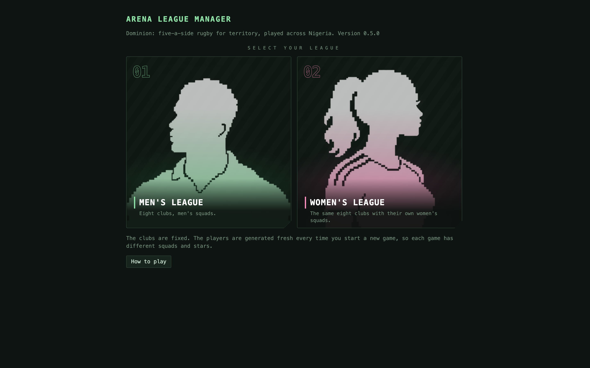
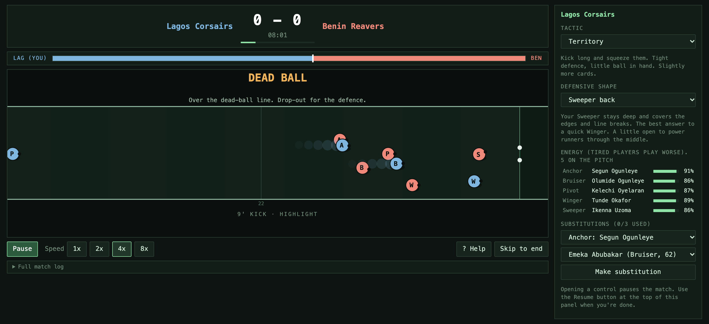
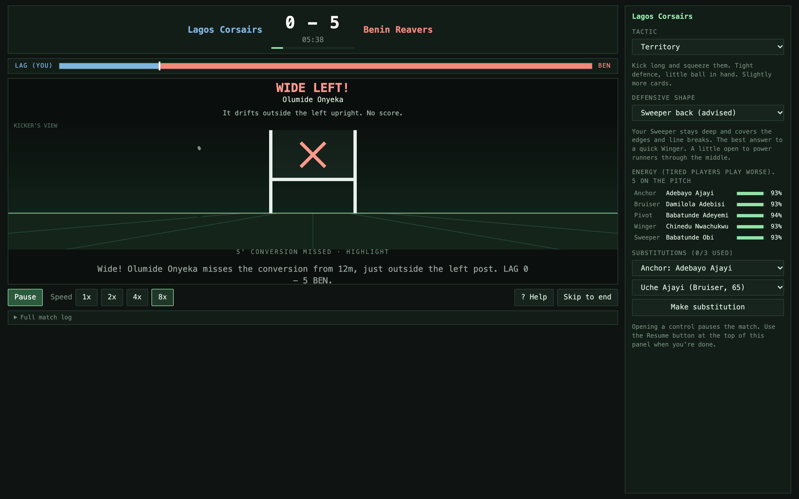
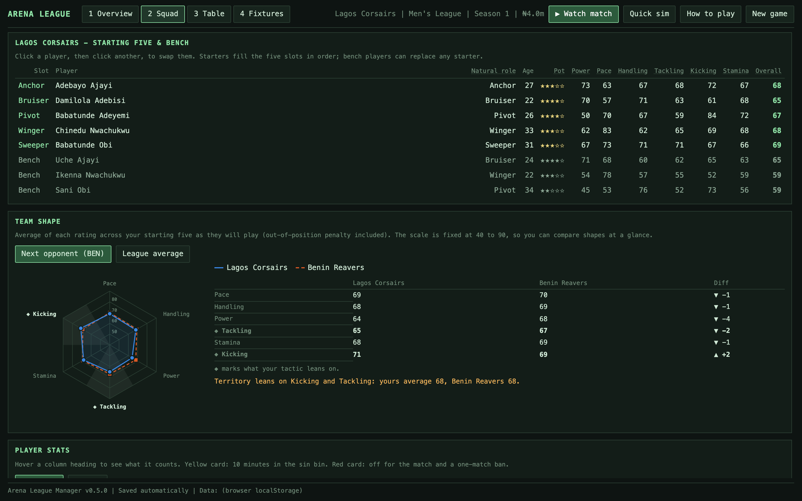
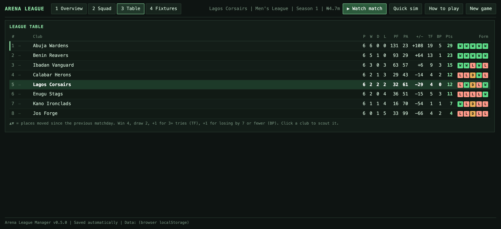

<h1 align="center">Dominion League Manager</h1>

<p align="center"><b>Coach a Nigerian club through a full season of Dominion, a brand-new five-a-side rugby sport.<br>Pick the five. Set the tactic. Then watch every try, tackle and missed kick unfold.</b></p>

<p align="center">
  
  
  
  
  
  
  
</p>

<p align="center">
  <a href="#why-youll-like-it">Why you'll like it</a> &bull;
  <a href="#see-it-in-action">Screenshots</a> &bull;
  <a href="#features">Features</a> &bull;
  <a href="#play-it">Play it</a> &bull;
  <a href="#architecture">Architecture</a> &bull;
  <a href="#contributing">Contributing</a>
</p>

<p align="center">
  
</p>

## Why you'll like it

Most management games make you take the sport on trust. Here, every decision shows up on the pitch.

- **A sport you have never played, learned in a minute.** Dominion mixes rugby union and rugby league, cut down to five players a side so every one of them matters. A built-in rulebook teaches it as you go.
- **Your choices are visible.** Change your defensive shape and watch the winger get through, or not. Play Attacking with a slow side and watch it fall apart. The numbers, the commentary and the animation always agree.
- **Matches you want to watch.** A match takes about three minutes. The top-down arena cuts in for the big moments, with real tackles, bouncing balls and kicks seen from behind the posts.
- **A career, not just a season.** Prospects grow, veterans fade and retire, and each offseason you sell, scout and buy under a wage bill.
- **Fully yours.** Offline, no account, no ads, no microtransactions. Your saves stay on your machine.

## See it in action

### The big moments play out in the arena

<p align="center"></p>

Each player is a small physics agent with a top speed, a reaction delay and a position (Anchor, Bruiser, Pivot, Winger, Sweeper). A pressure meter shows who owns the territory, and you can pause, substitute or change tactics mid-match.

### Kicks at goal from the kicker's view

<p align="center"></p>

Conversions, penalties and drop goals cut to a view from behind the kicker. Wide left, short, off the post and in: the picture and the commentary always match.

### Read your team like a scout

<p align="center"></p>

Set your starting five and see your team shape on a radar chart against your next opponent or the league average. The ratings your tactic leans on are marked, so you can see why a match-up favours you or not.

### Live the whole season

<p align="center"></p>

Win 4, draw 2, plus a bonus point for three or more tries and one for a close loss. Movement arrows, a form column, and any club one click from a scouting report.

## Features

- **Original sport.** Dominion has its own rules: 40 minutes, a 100 m arena, sets of six tackles, and tries, conversions, penalty goals and drop goals.
- **Deterministic match engine.** Pure TypeScript with a seeded RNG, no DOM and no I/O. The same seed gives the same match until you intervene, so it is testable and every match can be replayed.
- **Live match view.** A running clock, commentary that avoids repeating itself, a pressure meter, and arena highlights for line breaks, kicks, tackles, turnovers and cards.
- **Real coaching decisions.** Starting five and positions, four tactics, three defensive shapes, training focus, substitutions and half-time team talks.
- **Discipline that matters.** Yellow cards send a player to the sin bin and reds mean a suspension. A side playing a man down concedes far more tries.
- **Careers and the offseason.** Hidden potential, growth, decline and retirement. Sell players, sign youth prospects, buy from the transfer list.
- **Stats and awards.** Per-player season and career stats, a rated player of the match, and radar charts of the six ratings.
- **Men's and women's leagues.** The same eight clubs with separate squads, generated Nigerian player names and matching commentary.
- **Local saves.** Atomic writes with a backup of the previous save, and a browser fallback when run without Tauri.
- **Tested.** Vitest suites for the engine, balance, lifecycle and highlights, plus Rust tests for the save files.

## Play it

Dominion League Manager is early software and there are no packaged releases yet, so you run it from source (about two minutes with Node and Rust installed). See [Installation & development](#installation--development) for the full steps.

```sh
git clone https://github.com/anielhub-guru/dominion-rugby-manager.git
cd dominion-rugby-manager
npm install
npm run tauri dev
```

Want to try it without Rust? `npm run dev` runs the same game in your browser at `http://localhost:1420`, with saves kept in local storage.

## Architecture

| Path | Role |
|---|---|
| `src/engine/` | Match engine (`match.ts`), commentary (`commentary.ts`), seeded RNG, shared types. No DOM, no I/O. |
| `src/league/` | Teams, schedule, standings, season flow. Pure functions over a serialisable `SeasonState`. |
| `src/viewer/` | Table, highlight choreography (`scenes.ts`, pure and unit-tested), canvas renderer (`arena.ts`), live match controller (`live.ts`), the in-game rulebook (`rules.ts`), stat helpers. |
| `src/storage.ts`, `src/main.ts` | Persistence bridge and the app shell. |
| `src-tauri/src/lib.rs` | Rust commands that save to the app local data dir. |
| `tests/` | Vitest tests for the engine and league. |

## The game

Eight Nigerian clubs (Abuja Wardens, Benin Reavers, Calabar Herons, Kano Ironclads, Enugu Stags, Jos Forge, Lagos Corsairs, Ibadan Vanguard) play a 14-matchday season, in a men's or women's league. Clubs are fixed; players are generated from a seed each new game.

**Between matches** you pick the starting five, set a tactic (Balanced, Attacking, Defensive, Territory), a defensive shape (Sweeper back, Flat line, Narrow) and a training focus. Then you watch the match or quick-sim it.

**Dominion in brief:** 40 minutes, a 100 m arena, six tackles per set. Try 5, conversion 2, penalty goal 3, drop goal 3. Table points: win 4, draw 2, +1 for 3+ tries, +1 for a loss by 7 or fewer. Matches are deterministic from the save seed until you intervene.

**Beyond the match:** yellow and red cards, per-player stats, player of the match, hidden potential and retirement, an offseason market with a wage bill, and radar charts of team and player ratings.

The full rules, ratings, cards, tactics and economy are in the in-game **How to play** rulebook (source: `src/viewer/rules.ts`).

Keys: `Space`/`Enter` quick-sim (or pause/resume while watching), `1`-`4` switch tabs.

## Versioning

The current version is in `package.json` (also shown in the app footer). To release: bump `package.json`, `src-tauri/tauri.conf.json` and `src-tauri/Cargo.toml`, run `cd src-tauri && cargo update -w --offline` to refresh `Cargo.lock`, add a `CHANGELOG.md` entry, and tag the commit `vX.Y.Z`. `npm test` fails if the files disagree.

## Saves

After each matchday the app writes full match logs first, then the season, to the app local data directory (written atomically via temp file and rename):

- macOS: `~/Library/Application Support/com.dominionleague.manager/`
- Windows: `%LOCALAPPDATA%\com.dominionleague.manager\`
- Linux: `~/.local/share/com.dominionleague.manager/`

Contents: `saves/<game>/season.json` and `saves/<game>/matches/<fixtureId>.json`. Each game has its own folder, and each write keeps the previous save as `season.bak.json`. The start screen lists saved games with Continue and Delete; an old single save is moved into the first slot. Saves from versions 3 to 5 are upgraded on load; older ones are not compatible. The path is shown in the footer. In a plain browser (`npm run dev` without Tauri) it falls back to localStorage.

## Installation & development

Quick start (needs Node 20+ and Rust, see below):

```sh
git clone https://github.com/anielhub-guru/dominion-rugby-manager.git
cd dominion-rugby-manager
npm install
npm run tauri dev
```

### Prerequisites (all platforms)

Node 20+, Rust stable (via rustup), then `npm install`.

- **macOS**: Xcode Command Line Tools (`xcode-select --install`).
- **Windows**: Microsoft C++ Build Tools ("Desktop development with C++"), WebView2 (preinstalled on Windows 10/11), Rust MSVC toolchain. Bundles: NSIS `.exe` and WiX `.msi` (WiX needs Windows).
- **Linux (Debian/Ubuntu)**: `sudo apt install libwebkit2gtk-4.1-dev build-essential curl wget file libxdo-dev libssl-dev libayatana-appindicator3-dev librsvg2-dev`. Bundles: `.deb`, `.rpm`, `.AppImage`.

Tauri cannot cross-compile desktop installers reliably; build each OS on that OS (or in CI).

## Commands

```sh
npm install
npm test                      # engine and league tests
(cd src-tauri && cargo test)  # save-file tests
npm run tauri dev             # run the desktop app with hot reload
npm run tauri build           # package for the host OS
```

macOS specifics:

```sh
npm run tauri build -- --bundles app,dmg                          # host architecture
rustup target add x86_64-apple-darwin
npm run tauri build -- --target x86_64-apple-darwin --bundles app,dmg   # Intel build from Apple Silicon
rustup target add aarch64-apple-darwin x86_64-apple-darwin
npm run tauri build -- --target universal-apple-darwin --bundles app,dmg  # one universal binary
```

Output lands in `src-tauri/target/release/bundle/` (or `.../<target>/release/bundle/`). Builds are unsigned: on macOS right-click > Open the first time, or sign and notarise for distribution.

Windows: `npm run tauri build` (add `-- --bundles nsis` for just the installer). Linux: `npm run tauri build` (add `-- --bundles deb` etc.).

## Build and test status

Tested on macOS 26 (Darwin 25.4), **Intel x86_64** host, Node 22, Rust 1.96.

| Item | Status |
|---|---|
| TypeScript tests (`npm test`) | Pass (56 tests: engine, balance, highlights and scenes, cards and discipline, defensive shapes, player of the match, league, version consistency, attacking balance, 50-season lifecycle, offseason and economy, radar data) |
| Movement physics | Stepped frame by frame in a browser for every highlight kind: no teleporting (player steps stay within top speed), ball moves continuously (max about 0.5 m per frame). Acceleration spikes only at scripted tackles. |
| Kick outcomes | All five rendered and checked by eye: good, off the post and in, off the post, wide, short. |
| Resume button | Driven with a real click in a 560px-high window: appears when the substitution controls are touched, stays after a substitution, resumes the match. |
| Cards, stats, commentary and rulebook UI | Driven in headless Chromium against the production web build (Playwright): rules dialog opens with all 13 sections and tables fit, Squad tab shows season stats, a watched match shows the sin-bin chip, the 4-on-the-pitch count and a man-down highlight, the full-time panel lists cards and standout players, no page errors. **Not clicked through in the browser:** the SUSPENDED tag, the swap guard and the career toggle (the ban logic and career maths are unit-tested). |
| Rust tests (`cargo test`) | Pass (3 tests: id sanitising, atomic save round trip, backup of the previous save) |
| Spider chart | Rendered in headless Chrome with the game's real styles and generated teams (screenshot checked: legend, dashed second series, tactic wedge, values table). **Hover tooltips and keyboard focus not tested.** |
| Offseason screen, money display, attacking hint, and the chart as placed in the Squad and offseason tabs | **Not clicked through in a browser or the app.** The logic is unit-tested and the production build compiles; the offseason tables, buttons and header have not been seen on screen. |
| UI behaviour | Driven end to end in headless Chrome against the production web build: club pick, quick sim, table arrows, lineup swap, tactic/training, live match with substitution, half-time talk, skip, continue, reload restores the season (localStorage backend), replay. No page errors. |
| macOS x86_64 `.app` and `.dmg` | Built earlier and installed, but **not rebuilt since cards, stats, the new commentary and the rulebook were added**, so the installed app is out of date. Run `npm run tauri build -- --bundles app,dmg` to refresh it. |
| macOS arm64 / universal | Not built |
| Windows (`.exe`/`.msi`) | **Not built, not tested.** Instructions above only |
| Linux (`.deb`/`.AppImage`) | **Not built, not tested.** Instructions above only |
| Installed app: close and reopen restores season (Rust file backend) | **Not verified through the GUI.** No accessibility or screen-capture permission was available to click through the installed app. The Rust save/load code is unit-tested; the same UI logic was verified against the localStorage backend. Manual check: pick a club, press `Space` twice, quit, reopen. |

Saves from earlier builds (before the men's/women's league and Nigerian clubs) are not compatible; the app tells you and starting a new game overwrites them.

## Contributing

Bug reports and ideas are welcome. Contributions are accepted under the project's GPLv3 license. Open an issue first for anything bigger than a small fix. Before sending a change, run `npm test` and `(cd src-tauri && cargo test)`. A version bump must follow the steps in [Versioning](#versioning), and gameplay changes should get a line in `CHANGELOG.md`.

## License

Dominion League Manager is free software under the [GNU General Public License v3.0](LICENSE).

```
Dominion League Manager
Copyright (C) 2026 anielhub-guru

This program is free software: you can redistribute it and/or modify it under the terms of the
GNU General Public License as published by the Free Software Foundation, either version 3 of
the License, or (at your option) any later version.

This program is distributed in the hope that it will be useful, but WITHOUT ANY WARRANTY;
without even the implied warranty of MERCHANTABILITY or FITNESS FOR A PARTICULAR PURPOSE.
See the GNU General Public License for more details.
```

## Future targets

Android and iOS are not enabled. `lib.rs` already has the `mobile_entry_point` attribute; add them later with `npm run tauri android init` / `ios init`. The UI would need touch-friendly sizing.
